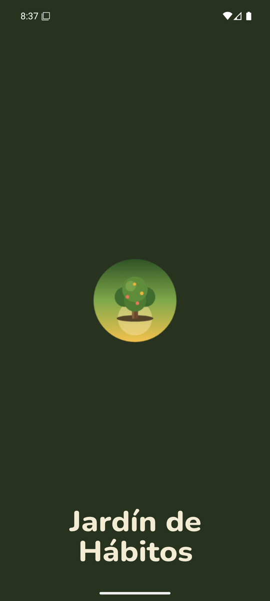
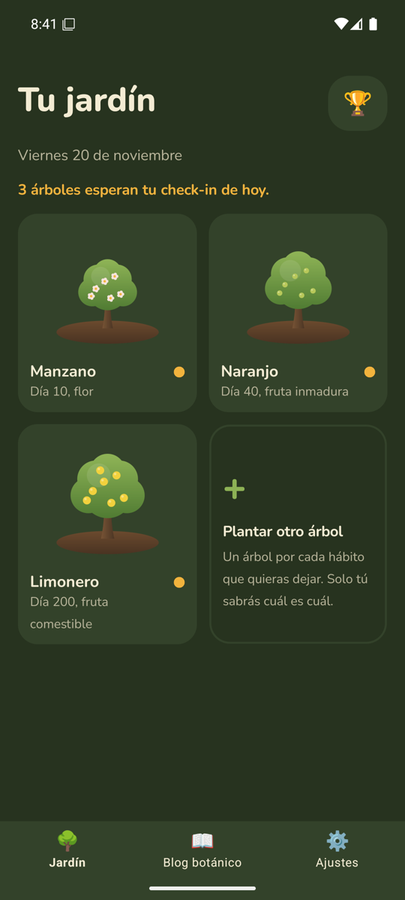
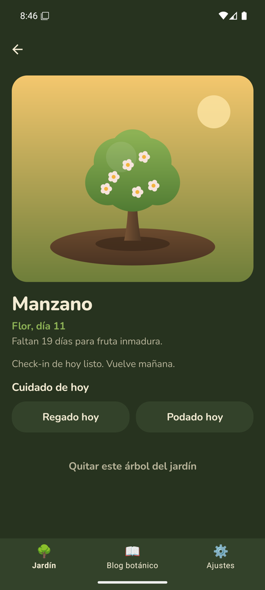
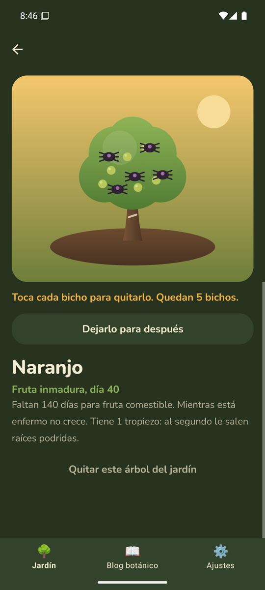
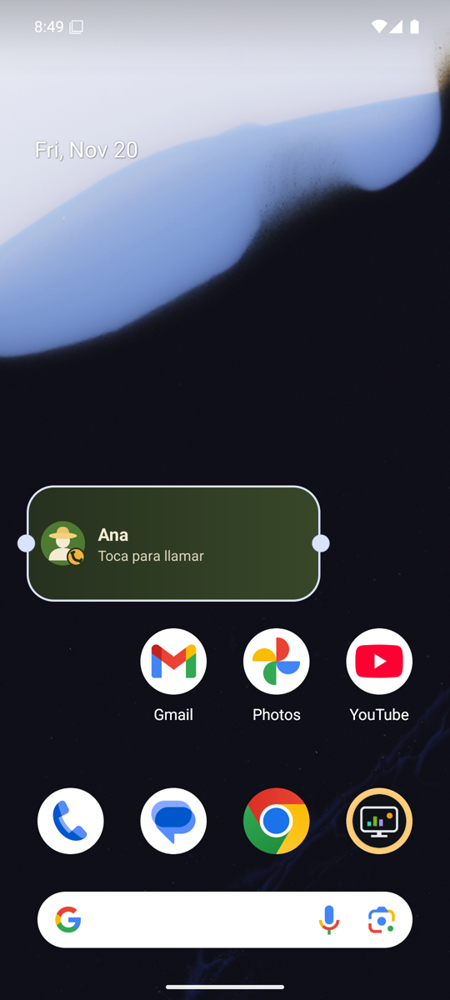
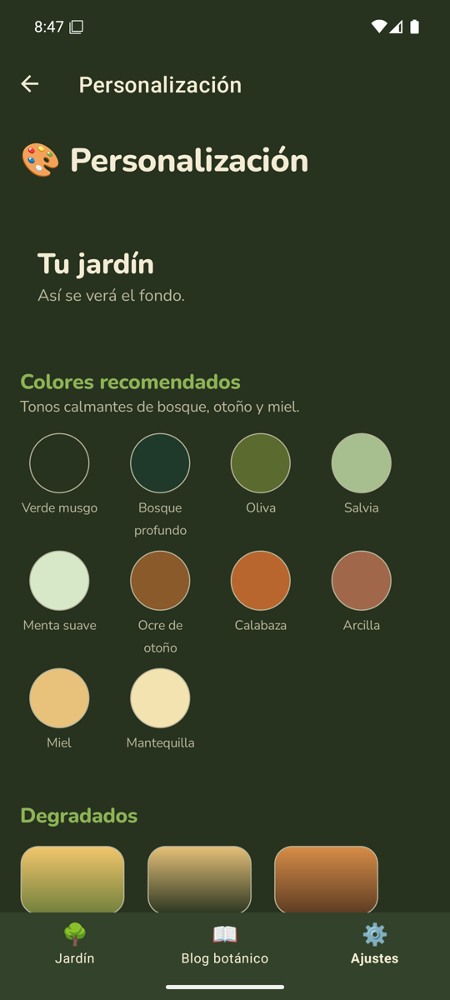
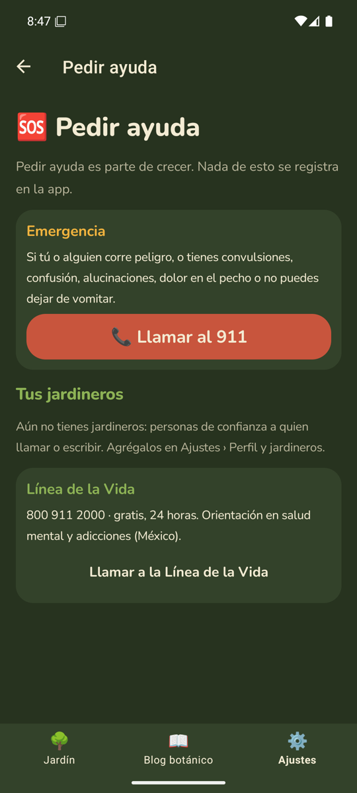
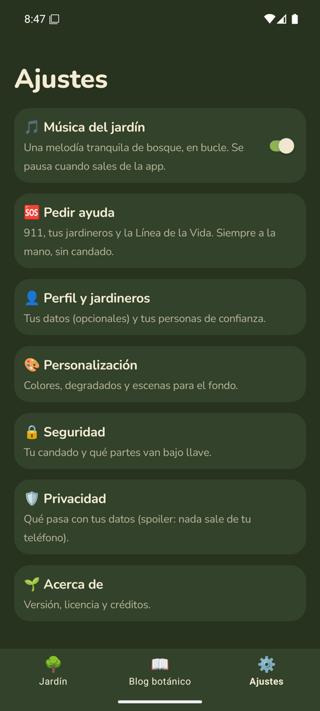

<p align="center">
  
</p>

<h1 align="center">Jardín de Hábitos</h1>

<p align="center">
  <b>Deja un mal hábito cuidando un jardín privado.</b><br>
  Cada día que cumples, tu árbol crece. Sin internet, sin cuentas, sin rastreadores.<br>
  <a href="../../releases/latest">Descargar APK</a> · <a href="LICENSE">Licencia MIT</a> · Android 10+
</p>

---

## ¿Para qué es?

Dejar un hábito (alcohol, cigarro, apuestas, pornografía, azúcar, pantallas…) toma **meses, no días**, y una recaída no es un fracaso: es parte del camino. Jardín de Hábitos convierte ese proceso en un jardín que cuidas a diario:

- **Cada hábito es un árbol.** Cumples tu meta del día → el árbol crece: semilla, brote, flor, fruta y, al año, **fruta legendaria**.
- **Una recaída enferma al árbol, no lo castiga.** Le cae una plaga o se le pudren las raíces; lo curas con mini-juegos y vuelve a crecer. Solo al tercer tropiezo vuelve a ser semilla.
- **Si dejas de visitarlo, se pausa.** No crece sin ti, y tras una semana aparecen pequeñas emergencias para invitarte a volver.
- **Logros con fundamento médico.** Los tiempos siguen la evidencia (NIAAA, DSM-5, NCI, NHS, FDA y estudios sobre formación de hábitos), no tiempos de videojuego.

## Capturas

| | | | |
|:-:|:-:|:-:|:-:|
|  |  |  |  |
| Inicio | Tu jardín | Un árbol de cerca | Curar una plaga |
|  |  |  |  |
| Widget "Llama a tu jardinero" | Personalización | Pedir ayuda | Ajustes |

*El estante de logros, el blog y las pantallas de candado no aparecen aquí a propósito: la app bloquea las capturas de esas pantallas.*

## Qué incluye

- **Jardín discreto.** En el jardín y en las notificaciones solo se ve la especie del árbol (manzano, cerezo, olivo…), nunca el hábito. Si alguien ve tu pantalla, solo ve un jardín.
- **12 hábitos de una lista** (sin escribir nada): los más dañinos (apuestas, pornografía, sustancias) solo se dejan por completo; otros se pueden moderar con días libres. Alcohol y sustancias muestran un aviso médico antes de empezar.
- **Logros en tres niveles** (bronce, plata, oro): generales, propios de cada hábito (10 o más por hábito) y algunos que solo descubrirás jugando.
- **Mini-juegos con gestos:** regar, podar, quitar bichos, sacar raíces podridas.
- **Candado a tu gusto:** el mismo bloqueo del teléfono, un PIN propio o un patrón propio, para el estante de logros, el blog o toda la app.
- **Pedir ayuda sin candado:** botón de 911, tus "jardineros" (personas de confianza) y la Línea de la Vida. Widget de pantalla de inicio para llamar a tu jardinero con un toque.
- **Música tranquila de bosque** (se apaga en Ajustes) y **fondos personalizables** en tonos calmantes.

## Privacidad

- **Nada sale de tu teléfono.** La app **no tiene permiso de internet**. No hay cuentas, servidores, analíticas, anuncios ni rastreadores.
- **Todo se guarda cifrado** (SQLCipher) con una llave aleatoria que vive en el almacenamiento seguro de Android.
- **Sin copias en la nube:** los respaldos automáticos están desactivados. Si desinstalas la app, se borra todo.
- **Tu PIN o patrón nunca se guarda**, solo una huella cifrada (PBKDF2-SHA256 con sal). Tras 20 intentos fallidos solo vale tu código de recuperación.
- Permisos que pide: notificaciones, reprogramar avisos al encender y biometría. Nada más.

El código es abierto precisamente para que cualquiera pueda comprobarlo.

## Instalar

1. Descarga el APK más reciente desde [Releases](../../releases/latest).
2. Ábrelo en tu teléfono y permite "instalar apps de esta fuente" si Android lo pide.
3. (Opcional) Verifica que el APK es auténtico: la huella SHA-256 del certificado de firma es

   ```
   CB:4E:1E:6A:3A:F7:AC:E2:05:92:14:DD:AA:05:AE:D6:E7:73:2D:23:32:23:55:F2:4E:89:7B:46:E4:82:B3:EF
   ```

   Con las herramientas de Android: `apksigner verify --print-certs jardin-de-habitos.apk`.

**Requisitos:** Android 10 o superior, procesador ARM de 64 bits (prácticamente todos los teléfonos actuales).

### F-Droid

El repositorio oficial de F-Droid exige compilar todo desde código fuente, y las herramientas de .NET MAUI para Android hoy se distribuyen precompiladas, así que por ahora no es posible publicarla ahí. El camino previsto es **[IzzyOnDroid](https://izzyondroid.org/)** (repositorio compatible con la app F-Droid), que toma el APK de los Releases de este repositorio. Los textos y capturas para las tiendas están en [`fastlane/`](fastlane/).

## Compilar desde el código

Necesitas el SDK de .NET 10 con la carga de trabajo `maui-android`, JDK 21 y el SDK de Android (API 36).

```bash
dotnet test tests/JardinDeHabitos.Core.Tests          # pruebas de la lógica
dotnet publish src/JardinDeHabitos.App -f net10.0-android -c Release
```

El APK queda en `src/JardinDeHabitos.App/bin/Release/net10.0-android/publish/`. Para probar una versión Release en un emulador x86_64 agrega `-p:Emulador=true`.

**Estructura:**
- `src/JardinDeHabitos.Core` — toda la lógica (crecimiento, strikes, logros, cifrado, seguridad), sin interfaz, con pruebas.
- `src/JardinDeHabitos.App` — la app Android (.NET MAUI).
- `tests/` — pruebas xUnit.
- `docs/` — diseño, fundamentos médicos y planes.

## Fundamentos médicos

Las reglas y los tiempos se basan en fuentes acreditadas; el detalle y los enlaces están en [`docs/superpowers/specs/2026-11-19-jardin-secreto-logros-design.md`](docs/superpowers/specs/2026-11-19-jardin-secreto-logros-design.md).

> **Esta app no sustituye ayuda profesional.** Dejar de golpe el alcohol o ciertos medicamentos después de un uso diario puede ser peligroso: habla con un médico. En México: Línea de la Vida **800 911 2000** (gratis, 24 h). Urgencias: **911**.

## Licencia y créditos

Código bajo [licencia MIT](LICENSE). Música "Forest Ambience" de TinyWorlds (CC0) y demás recursos listados en [`ASSETS.md`](ASSETS.md).

¿Quieres ayudar? Los reportes de errores y las propuestas son bienvenidos en *Issues*.
